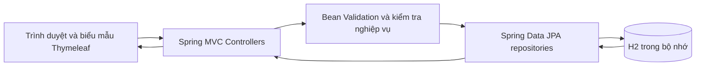

# Hướng dẫn chạy và bằng chứng báo cáo giữa kỳ R01 K06

## Phiên bản và môi trường đã kiểm tra

- Mã nguồn: `spring-petclinic/`, commit `500158f732419217507c7656904b8e6aa1bcc0d6`.
- Kiểm tra thực tế ngày 15/10/2026 (giờ California) trên Windows, OpenJDK `25.0.4.1`, Spring Boot `4.1.0`, cổng `8080`.
- Dự án yêu cầu Java từ 17 trở lên. Dùng Maven Wrapper có sẵn; không cần cài Maven riêng.
- Cấu hình mặc định là H2 trong bộ nhớ. `application.properties` chọn `database=h2`; dữ liệu mẫu nạp từ `src/main/resources/db/h2/schema.sql` và `data.sql`. Dữ liệu thêm khi chạy sẽ mất sau khi dừng ứng dụng.

## Chạy lại từ máy Windows

Mở PowerShell tại thư mục `spring-petclinic`:

```powershell
java -version
git rev-parse HEAD
.\mvnw.cmd spring-boot:run
```

Đợi dòng `Started PetClinicApplication`, rồi mở `http://localhost:8080/`. Không cần biến môi trường hay dịch vụ cơ sở dữ liệu ngoài cho cấu hình mặc định. Nếu cổng 8080 đang dùng, giải phóng cổng hoặc đặt `SERVER_PORT` và điều chỉnh `PETCLINIC_URL` khi chạy script.

Ở PowerShell thứ hai tại thư mục `KTPM`:

```powershell
node .\demo_3_luong.mjs
```

Script dùng Node.js 18 trở lên và chỉ dùng thư viện chuẩn. Nó tạo dữ liệu mới mỗi lần chạy, kiểm tra HTTP và nội dung hiển thị, rồi ghi HTML cùng `ket_qua.json` vào `output/bang_chung_chay_app/`. Các file bằng chứng bị ghi đè khi chạy lại. Sau khi chạy, mở `/owners/{ownerId}` theo ID trong JSON để demo trực tiếp. Dừng Maven bằng `Ctrl+C` khi kết thúc.

## Kết quả chạy thực tế

Lần chạy lúc `2026-10-16T06:36:07Z` trả về `PASS` cho bốn bước: thêm chủ nuôi, tìm đúng chủ nuôi, thêm thú nuôi và ghi nhận lượt khám. Chủ nuôi có ID `13`, thú nuôi ID `15`; ngày khám `2026-10-16`. Ba luồng nghiệp vụ cần cho báo cáo là chủ nuôi, thú nuôi và lượt khám. Kết quả chi tiết nằm ở [ket_qua.json](output/bang_chung_chay_app/ket_qua.json).

- [Ảnh trang chủ](output/bang_chung_chay_app/01_trang_chu.png) chứng minh ứng dụng mở trên cổng 8080.
- [Ảnh hồ sơ sau tìm kiếm](output/bang_chung_chay_app/02_tim_chu_nuoi.png) cho thấy chủ nuôi vừa tạo.
- [Ảnh hồ sơ có thú nuôi và lượt khám](output/bang_chung_chay_app/04_luot_kham.png) cho thấy hai bản ghi liên quan.
- HTML từng bước: `01_trang_chu.html`, `02_chu_nuoi.html`, `03_thu_nuoi.html`, `04_luot_kham.html` trong cùng thư mục bằng chứng. HTML có thể mở để đối chiếu nội dung, nhưng CSS dùng đường dẫn tới ứng dụng đang chạy.

Script kiểm tra phản hồi POST chuyển hướng tới hồ sơ, rồi đọc lại trang hồ sơ và xác nhận dữ liệu mới xuất hiện. Đây là bằng chứng chạy ba luồng trên giao diện HTTP. Phần Pairwise và các ca dữ liệu sai đã được chạy tiếp ngày 17/10/2026; xem [kết quả K06](pairwise_owner/KET_QUA_K06.md).

Để chạy lại toàn bộ bài trong một lệnh sau khi PetClinic khởi động, tại thư mục `KTPM` dùng `node run_r01_k06.mjs`. Kết quả mới được ghi vào [JSON tổng hợp](output/R01_K06_tong_hop.json) và [bảng CSV](output/R01_K06_ket_qua_ca.csv); các tệp bằng chứng của từng ca được ghi đè mỗi lần chạy.

## Kiến trúc và ba luồng dữ liệu



| Luồng | Đường dẫn và xử lý | Dữ liệu |
| --- | --- | --- |
| Tìm hoặc thêm chủ nuôi | `/owners/find`, `/owners`, `/owners/new` → `OwnerController` → `OwnerRepository` | `Owner`, bảng `owners` |
| Thêm thú nuôi | `/owners/{ownerId}/pets/new` → `PetController` → `OwnerRepository` và `PetTypeRepository` | `Pet`, `PetType`, bảng `pets`, `types` |
| Ghi nhận lượt khám | `/owners/{ownerId}/pets/{petId}/visits/new` → `VisitController` → `OwnerRepository` | `Visit`, bảng `visits` |

`OwnerController`, `PetController`, `VisitController` nhận dữ liệu từ form và trả về template Thymeleaf hoặc chuyển hướng. Các entity `Owner`, `Pet`, `Visit` liên kết với nhau; `OwnerRepository` lưu cây dữ liệu chủ nuôi. Quy tắc kiểm tra gồm dữ liệu bắt buộc, tên thú nuôi không trùng trong một chủ nuôi và ngày khám phải sau ngày hiện tại. Sơ đồ này mô tả một ứng dụng Spring Boot chạy cùng H2, không có dịch vụ tách riêng.

## Demo trực tiếp khi thuyết trình

1. Mở trang chủ và `/owners/find`, tìm họ trong `ket_qua.json`.
2. Mở hồ sơ chủ nuôi, chỉ ra thông tin và thú nuôi mới. Có thể bấm **Add New Pet** để giới thiệu form.
3. Trong mục **Pets and Visits**, chỉ ra ngày và mô tả lượt khám; bấm **Add Visit** để giới thiệu form. Dùng ảnh đã lưu nếu dữ liệu H2 bị xóa do khởi động lại.
