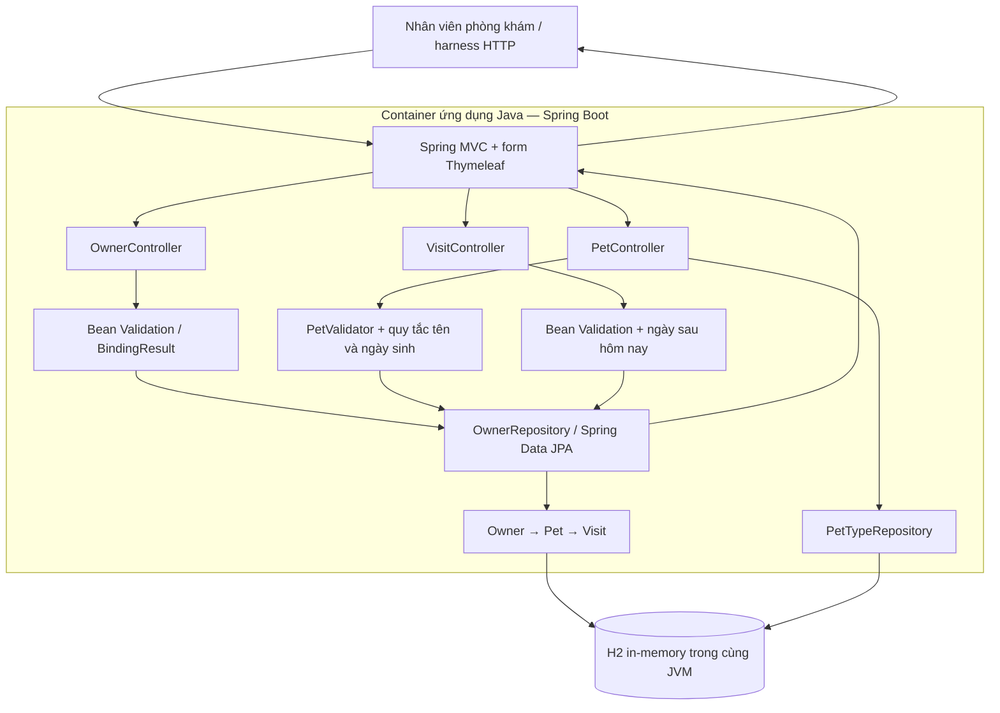
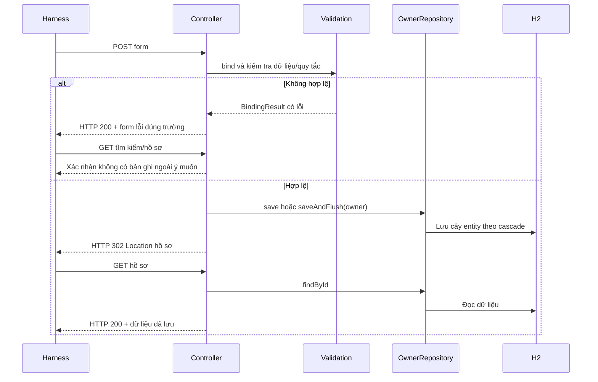

# Kiến trúc và luồng dữ liệu

Đây là kiến trúc một ứng dụng, không phải nhiều microservice. H2 chạy trong JVM của ứng dụng; khối H2 biểu diễn nơi lưu trữ logic. Các controller gọi repository trực tiếp. Template nhận model để dựng form lỗi hoặc trang chi tiết.

Đối chiếu từng module và URL trong [phân tích hệ thống](system-analysis.md). Sơ đồ phản ánh mã nguồn đã pin trong [phiên bản](version.md); chức năng lịch hẹn/bệnh án chưa commit ở workspace khác không thuộc sơ đồ này.
